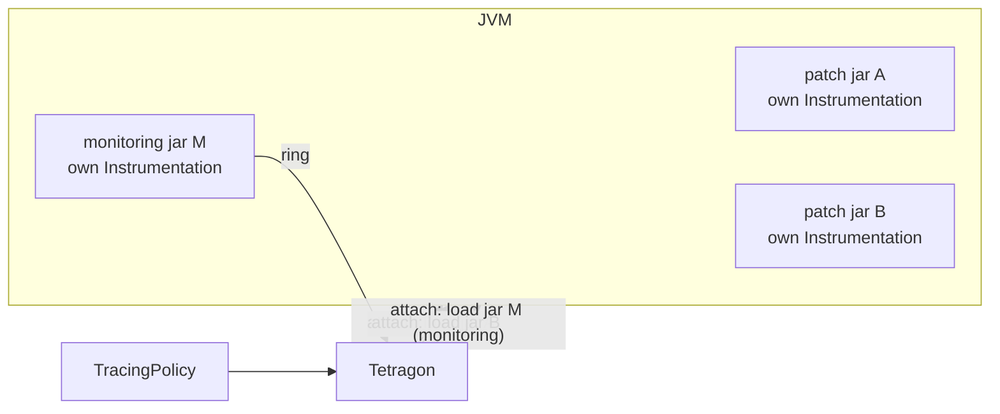
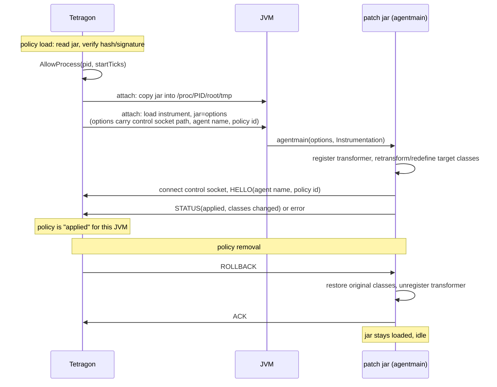

> **Status: design proposal.** Nothing here is implemented. It is an
> alternative to the "Proposal: class patching" section of
> [Java attachment](../java-attachment/). Statements about JVM behavior that
> have not been tested are marked as such.

## Idea

The current design has one native JVMTI agent that does everything: the
control protocol, the ring, instrumentation, and (in the proposal) patching.

The alternative is to make the JVM the place where "agents" are a normal,
repeatable concept. Tetragon asks the JVM, through the same HotSpot attach
interface, to load **any number of agent jars**. Each jar is independent:

* one jar per patch (one fix, one class or a few related ones),
* one jar for monitoring (the method-entry events described in the main
  page),
* later, other jars (advice, guards, ...) without changing Tetragon or the
  protocol.

Tetragon becomes a **loader and supervisor** of jars. What a jar does inside
the JVM is the jar's business.



## What the JVM gives us

Behavior of the standard `java.lang.instrument` mechanism, as exposed by the
HotSpot attach interface:

* Attach can load a jar at any time (`load instrument`, the jar path and an
  option string as arguments). Each load runs the jar's `agentmain` once.
* Each loaded jar gets its **own** `Instrumentation` handle and registers its
  own transformers. The JVM keeps no list of agents and does not limit their
  number.
* A transformer sees every class loaded after it is registered. It can ask
  for already-loaded classes to be retransformed or redefined.
* Retransform and redefine need `Can-Retransform-Classes: true` /
  `Can-Redefine-Classes: true` in the jar manifest.
* Redefine and retransform cannot add or remove fields or methods, change
  signatures or change the class hierarchy. A fix that needs that cannot be
  done by any agent.
* **A loaded agent cannot be unloaded.** It stays until the JVM exits.

The last point shapes the whole design: removal and rollback must be done by
the agent itself, on request.

## Architecture

### Roles

| Role | Where | Job |
|---|---|---|
| Loader | Tetragon | pick jars from the policy, verify them, ask the JVM to load them, track what is loaded in which JVM |
| Patch jar | JVM | apply one fix; know how to undo it |
| Monitoring jar | JVM | instrument methods, write events to the ring |
| Control channel | socket | tell an already-loaded jar to roll back, report status |

### Policy

The policy would list jars instead of class bytes:

```yaml
spec:
  java:
    targets:
      executables:
        - /usr/lib/jvm/java-21-openjdk/bin/java
      processArgsContains:
        - my-service.jar
    agents:
      - name: sql-guard
        jar: /etc/tetragon/java-agents/sql-guard.jar
        sha256: 3b1f...
        options: "mode=block"
    hooks:            # unchanged; handled by the built-in monitoring agent
      - class: com.example.RequestHandler
        message: Request handler called
```

* `agents` are patch/advice jars supplied by the user.
* `hooks` keep working as today. Internally Tetragon loads its own
  monitoring jar for them. This is the same mechanism, only with a jar that
  ships with Tetragon.
* `sha256` (or a signature, see Security) is checked by Tetragon before the
  jar is handed to the JVM.

### Delivery flow



Tetragon keeps, per JVM, a table `(agent name, policy id) -> state`
(loaded, applied, rolled back). Loading is idempotent: a jar already loaded
for a policy is never loaded a second time; if the policy comes back after a
rollback, Tetragon sends an `APPLY` over the control channel instead.

### What stays and what changes in the protocol

| Part | Native-agent design | Agent-jar design |
|---|---|---|
| Loading | `load <lib.so>` (JVMTI library) | `load instrument <jar>` (once per jar) |
| Control channel | one session per JVM | one session per **agent** (jar), identified in HELLO |
| New control messages | PATCH_APPLY with memfd of class files | none for delivery: the class bytes are inside the jar. Only APPLY / ROLLBACK / STATUS |
| Ring | created for the one agent | only the monitoring jar gets a ring |
| Patch content | policy points to `.class` files, read by Tetragon | jar contains replacement and original bytes |

HELLO would gain an agent-name field so that several sessions from one JVM
can be told apart, and `AllowProcess` would allow a bounded number of
sessions per `(pid, startTicks)` (one per loaded agent) instead of one.

## Patching as a jar

A patch jar is small and self-contained:

```
sql-guard.jar
  META-INF/MANIFEST.MF
      Agent-Class: io.example.SqlGuardAgent
      Can-Redefine-Classes: true
      Can-Retransform-Classes: true
  io/example/SqlGuardAgent.class
  patched/com/example/Db.class        replacement bytes
```

`agentmain` does:

1. Read the original bytes of each target class (from the transformer
   callback or from the class loader) and keep them for rollback.
2. Redefine the loaded classes with the replacement bytes
   (`redefineClasses`), or register a `ClassFileTransformer` that rewrites
   the class and call `retransformClasses`. The transformer form also covers
   classes loaded later, which redefine alone does not.
3. Report the outcome to Tetragon.

Rollback: restore the saved original bytes, unregister the transformer, call
`retransformClasses` so the class is rebuilt without it.

This moves the hard parts (which classes, which loaders, which bytes) out of
Tetragon. The patch author decides, and can use the full
`java.lang.instrument` API, including advice style patches (entry probe,
throw before a method runs) that class-file replacement cannot express
cleanly.

## Monitoring as a jar

Monitoring is "just another agent" in the loader's view, but it is a special
one because of the ring:

* It is a jar shipped with Tetragon, loaded when the policy has `hooks`.
* The ring is a memfd mapped into the JVM. Plain Java cannot `mmap` an
  inherited fd. There are three ways to do it:

| Option | How | Comment |
|---|---|---|
| A. Keep the native JVMTI library | The monitoring jar's `agentmain` loads the existing native library (`System.load`) which maps the ring and does the bytecode rewriting as today | smallest change; two things to ship (jar + `.so`) |
| B. JNI helper only | Jar rewrites bytecode in Java (ASM), a tiny native lib maps the ring and implements `enter()` | Java does the hard part, native stays minimal |
| C. Java FFM | Use the foreign-memory API to map the ring | no native code, but needs a recent JDK (22+); not usable on older JVMs |

Recommended: **A for the first version**. It keeps the tested instrumentation
and ring code unchanged and only changes how the library is brought in: the
monitoring jar becomes a thin launcher. That also means the monitoring agent
and patch jars can be developed independently.

## Several agents in one JVM

Tetragon can send any number of load requests to one JVM. Practical effects:

### Ordering and interaction (the risky part)

* All transformers registered by all agents run on every class load and
  every retransform. The order is fixed by the JVM, but it depends on how
  agents were registered, which is a detail Tetragon should not rely on.
* If two agents change the same method, the result depends on that order.
  *Not tested.*
* Retransform runs transformers again over the original bytes. A
  retransform-capable transformer must therefore be a pure function of its
  input, not "apply once".
* Redefine with new bytes also passes through registered transformers (JVM
  behavior, not tested here). If so, the monitoring jar would re-instrument
  a patched class automatically, and re-instrument the original class after
  rollback. This is the property that lets monitoring and patching coexist,
  and it must be verified before anything else.

Rules to keep this manageable:

1. **One patch jar per class.** Tetragon rejects two policies that name the
   same class in their metadata (a manifest attribute such as
   `Tetragon-Classes`). Not enforceable for what the jar really does, only
   for what it declares.
2. Whether monitoring sees the patched or the original method depends on
   transformer order. Until that is verified, document that monitoring of a
   patched method is best effort.
3. Agents must not assume they are alone.

### Cost

Each agent adds a transformer that runs on every class load and retransform.
A dozen agents is fine; a hundred has not been measured. Agents should
return `null` (no change) quickly for classes they do not care about.

### Limits and failure

| Case | Behavior |
|---|---|
| Jar load fails (bad manifest, missing permission) | attach reply carries an error; policy load fails or is retried for later JVMs |
| Schema change in a patch | JVM rejects it; agent reports error in STATUS; Tetragon marks the policy failed for that JVM |
| Agent crashes in `agentmain` | JVM may log and continue; no STATUS arrives, Tetragon times out and marks failure |
| Agent throws in a transformer | JVM ignores the transformer's result for that class; class stays unmodified |
| Tetragon exits | agents and their patches stay; rollback happens only when a policy is removed while Tetragon runs |
| JVM exits | all state is gone, nothing to clean |

## Security

This design widens the trust surface: each jar is **arbitrary code inside
the JVM**, loaded by a root daemon at the request of whoever can create a
TracingPolicy.

* Tetragon should only load jars from an allow-listed directory, owned by
  root and not writable by others (so a policy cannot point at any file).
* Every jar is verified before loading: a pinned `sha256` in the policy at
  minimum, ideally a signature checked against a configured key. The check
  and the copy into the target's `/tmp` must be done from the same open file
  descriptor, not by path, to avoid swapping the file in between.
* The copy in the target's `/tmp` is created with restrictive permissions and
  removed after the attach, as for the native library today.
* Control sessions from agents are authenticated like today
  (`SO_PEERCRED` plus `(pid, startTicks)`), with the added per-agent
  session limit.
* A signed jar can still be wrong. Patching is a powerful operation and
  should stay opt-in (an agent setting, off by default), separate from the
  monitoring feature.

## Comparison with the class-file design

| | Class-file patch (main page proposal) | Agent jars (this page) |
|---|---|---|
| What Tetragon ships to the JVM | class bytes in a memfd | a jar |
| Who knows how to patch | Tetragon (RedefineClasses in native agent) | the jar |
| Expressiveness | whole-class replacement, same schema | anything `java.lang.instrument` allows, incl. transformers and advice |
| Classes loaded later | not covered | covered by a transformer |
| Rollback | Tetragon-held original bytes | jar-held original bytes, jar must be written correctly |
| Multiple fixes | one policy per class | many independent jars; interactions possible |
| Monitoring | built into the native agent | one more jar (launcher) plus native library |
| New code in Tetragon | PATCH_APPLY, memfd handling | jar loader, per-agent sessions, APPLY/ROLLBACK/STATUS |
| Main risk | limited to what redefine can do | arbitrary code in the JVM; agent interaction and ordering |
| Debuggability | Tetragon sees exactly what was applied | Tetragon only sees what the jar reports |

## Assessment

**Good**

* Tetragon stops knowing about patch content. Adding a new kind of fix is
  shipping a jar, not changing the protocol.
* Fixes are independent and can be added or removed one at a time.
* Covers classes that load after the attach, which the class-file design
  does not.
* Monitoring and patching use one delivery path, so there is one thing to
  harden and test.

**Costs**

* Rollback correctness moves to every jar author. A jar that forgets to
  undo something leaves the JVM patched after the policy is gone, and
  Tetragon cannot tell.
* Agents cannot be unloaded, so a long-lived JVM accumulates idle agents and
  transformers.
* Trust: arbitrary code in the target process, so signing and allow-listing
  are mandatory, not optional.
* Multiple agents on the same class have undefined interaction until tested.

**Open questions to answer before building**

1. Does a redefine, as done by one agent, run the transformers of the other
   agents (monitoring in particular)? Test on JDK 11, 17, 21.
2. Can the monitoring jar stay a thin launcher for the existing native
   library on all supported JDKs, including when the JVM runs in a container
   (the jar and the `.so` both need to be visible in its mount namespace)?
3. What is the minimum contract a jar must follow (manifest keys,
   `APPLY`/`ROLLBACK` handling, no state outside its own classes)? A small
   SDK jar for patch authors would enforce it.
4. How does Tetragon report "agent applied" in the policy status and in
   events (a new event type, or a field of the policy state)?

**Suggested path**

1. Prototype one patch jar loaded by hand through the attach interface next
   to the existing native agent, and answer question 1.
2. Add the jar loader and per-agent control sessions in Tetragon, with hash
   verification and an allow-listed directory.
3. Move patching to it. Keep native monitoring as is, then wrap it in a
   launcher jar only if there is a reason (for example, one uniform status
   view per JVM).
