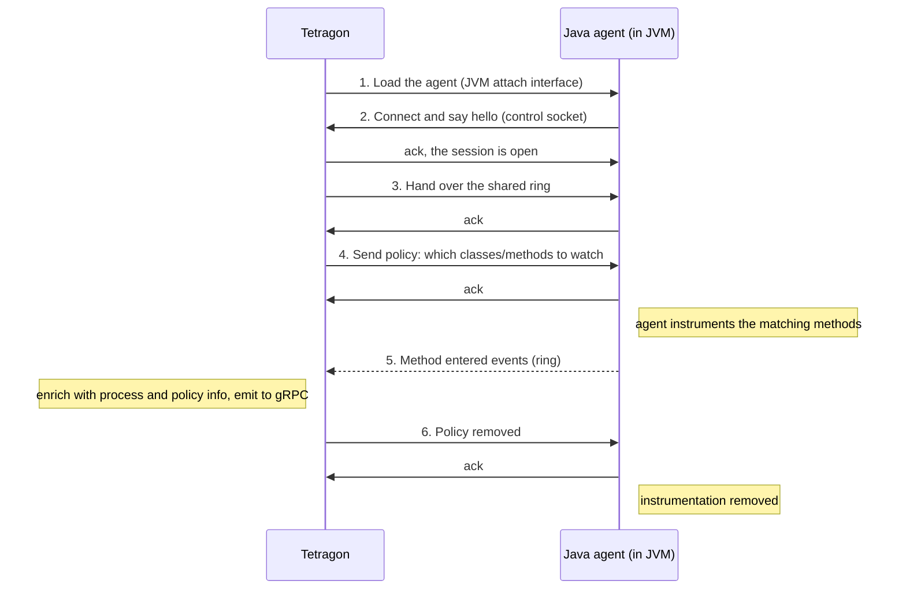
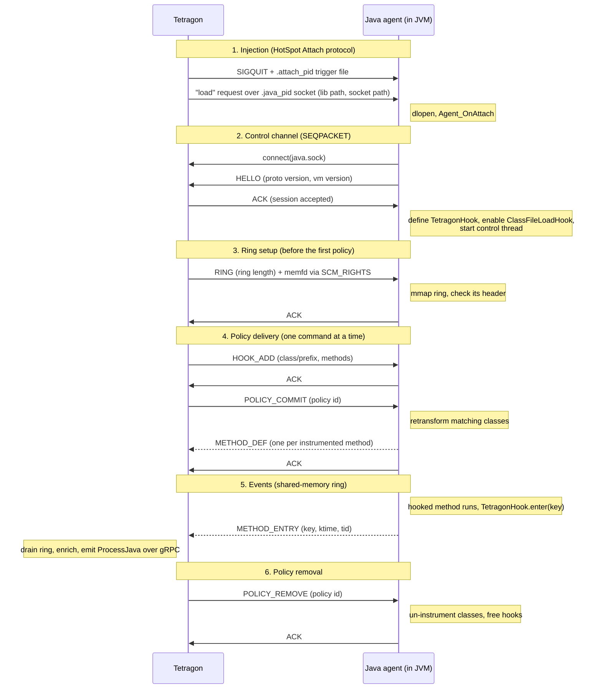
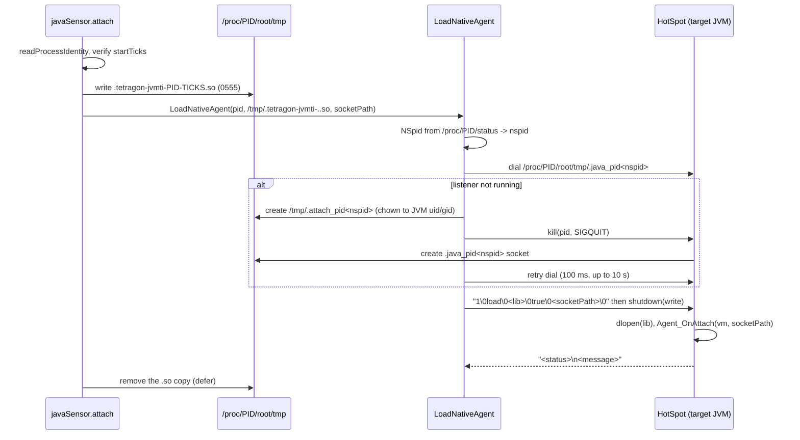
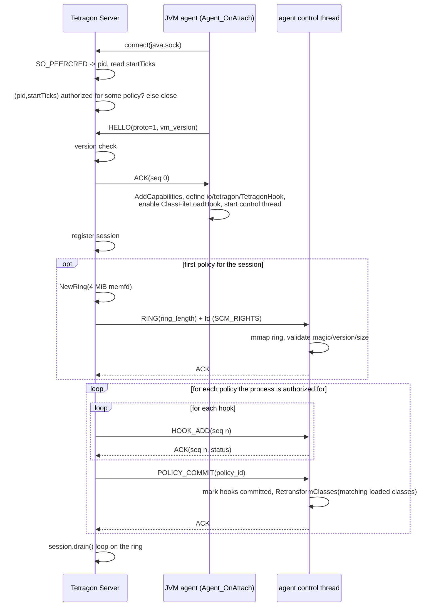
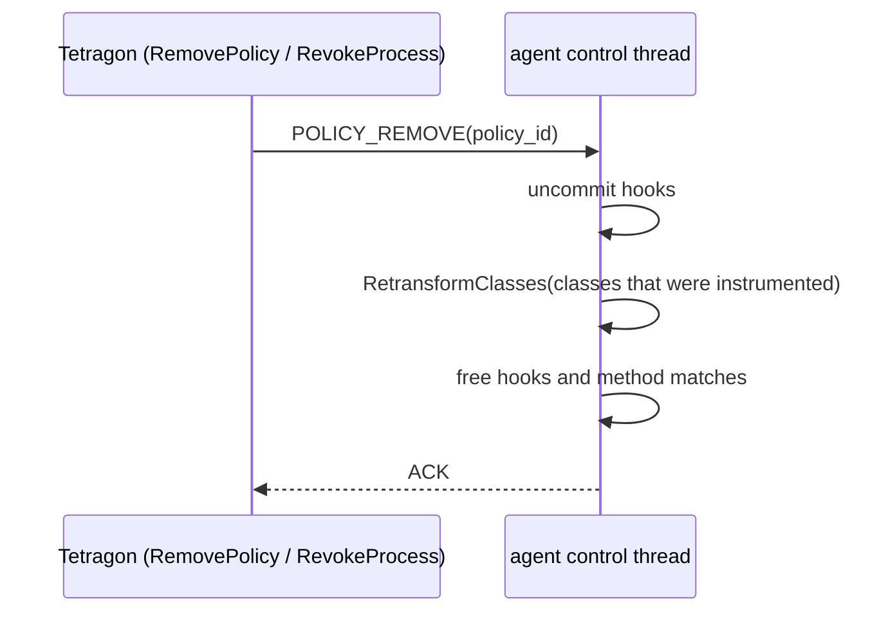
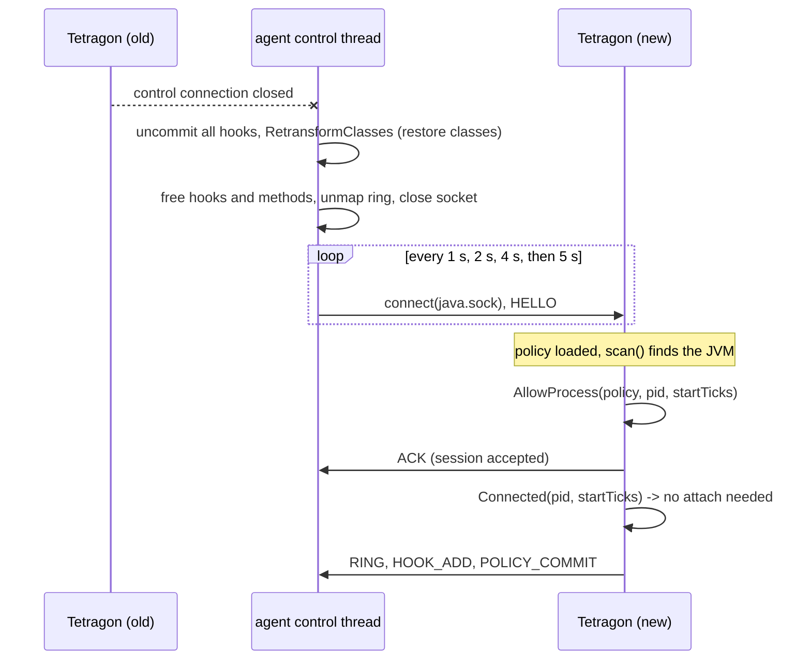
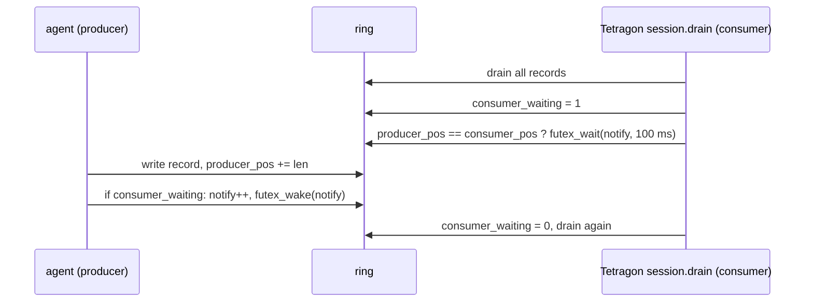
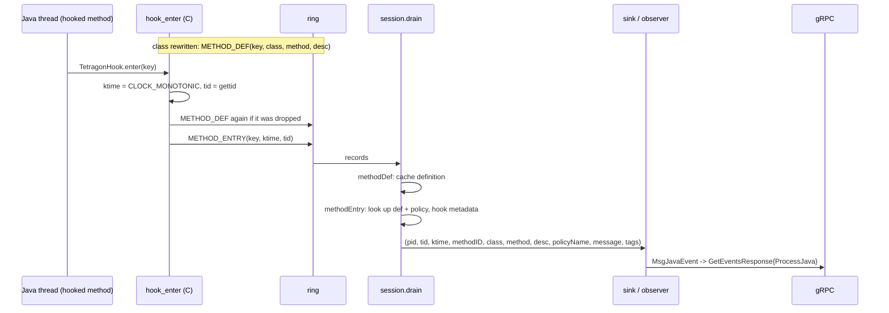

Tetragon can trace method calls inside running Java VMs. A `java:` section
in a TracingPolicy lists the classes and methods to watch, and Tetragon
produces an event each time one of them is entered.

## Overview

Java has no kernel hooks to attach to, so Tetragon injects a small native
agent (a JVMTI library) into the target JVM. The agent rewrites the watched
methods so that they report back to Tetragon.

The whole thing is built from three communication channels:

| Channel | Used for | Direction |
|---|---|---|
| JVM attach interface | one-time: make the JVM load the agent | Tetragon -> JVM |
| Control socket | handshake, ring setup, policies (which methods to watch) | both ways |
| Shared-memory ring | the actual events (method entered) | JVM -> Tetragon |



In words:

1. Tetragon finds JVMs that match the policy's targets and asks each one,
   through the standard JVM attach interface, to load the agent library.
2. The agent connects back to Tetragon on a unix socket. Tetragon only
   accepts connections from JVMs it authorized for some policy.
3. Before the first policy is sent, Tetragon creates a shared-memory ring
   buffer and gives it to the agent.
4. Tetragon sends the policy: the classes and methods to watch. The agent
   rewrites those methods, including classes that are already loaded.
5. When a watched method runs, the agent writes a small record to the ring.
   Tetragon reads it, adds process and policy information, and emits it as
   an event.
6. When the policy is removed, Tetragon tells the agent, which undoes the
   instrumentation. The library itself stays loaded in the JVM, idle.

The agent also survives a Tetragon restart: it removes its instrumentation
when the connection breaks and keeps trying to connect back, so the new
Tetragon instance does not need to attach again (see
[Reconnect](#6-reconnect-after-tetragon-restart)).

The rest of this page goes into detail: how JVMs are found and attached, and
the exact format of every message.

## Example policy

```yaml
apiVersion: cilium.io/v1alpha1
kind: TracingPolicy
metadata:
  name: java-example
spec:
  java:
    targets:
      # Optional. Select JVMs by executable path and/or by process arguments
      # (every token must appear in one of the arguments). Without
      # executables, any process that has libjvm.so mapped is considered.
      executables:
        - /usr/lib/jvm/java-17-openjdk-amd64/bin/java
      processArgsContains:
        - my-service.jar
    hooks:
      # Exact class, selected methods (all overloads of "handle").
      - class: com.example.RequestHandler
        methods:
          - name: handle
        message: Request handler called
        tags:
          - java
          - request
      # Exact class, a single overload picked by its JVM descriptor.
      - class: com.example.auth.TokenValidator
        methods:
          - name: validate
            descriptor: (Ljava/lang/String;)Z
        message: Token validation
      # Every method of every class under a package prefix.
      - classPrefix: com.example.db.
        message: Database layer call
        tags:
          - java
          - db
```

* `targets` selects the JVMs. Both fields are optional, but a policy needs
  at least one hook or one executable target.
* Each hook needs exactly one of `class` (exact, dotted form, nested classes
  use `$`) or `classPrefix`.
* `methods` limits the hook to the named methods. All overloads match unless
  a `descriptor` is given. Without `methods`, all methods of the matching
  classes are monitored.
* `message` (max 256 characters) and `tags` (max 16) are copied into every
  event produced by that hook. They stay on the Tetragon side and are never
  sent to the JVM.
* Classes in `java/`, `jdk/` and `sun/` cannot be hooked.
* Java policies do not support policy filtering (namespaced policies, pod
  and container selectors) yet.

A smaller runnable policy is in `examples/java/demo-tracingpolicy.yaml`.

Conventions: all integers are **little-endian**. A `str` is a `u16` length
followed by that many bytes (no NUL terminator). Class names use internal
form (`a/b/C`).

## 1. Message flow



Three channels are involved:

1. **HotSpot Attach protocol**: one-shot, Tetragon to JVM, makes the JVM
   `dlopen` the agent.
2. **Control channel**: `AF_UNIX`/`SOCK_SEQPACKET` socket, opened by the agent
   to Tetragon. Carries the handshake, the ring setup and policy commands.
3. **Data ring**: memfd shared memory created by Tetragon, mapped by both
   sides. Carries method definitions and entry events from the JVM.

## 2. Policy load

`policyHandler.PolicyHandler` (`java_linux.go`) is registered at init for the
`java` spec section.

1. Rejects policy filtering (`filterID != NoFilterID`).
2. Validates `targets.executables` (absolute, clean, no NUL) and
   `targets.processArgsContains` (non-empty, no NUL). A policy without hooks
   must name at least one executable.
3. If hooks are present, resolves the native agent library, in order:
   `--java-agent-path`, `<cwd>/pkg/javaattach/agent/tetragon-jvmti.so`,
   `/usr/lib/tetragon/tetragon-jvmti.so`. A configured path that does not
   exist is an error, there is no fallback for it.
4. Builds a `javaagent.Policy`:
   * `ID` = FNV-1a hash of the policy long name (never 0), so the policy
     keeps its id across Tetragon restarts,
   * one `Hook` per `spec.hooks[i]` (`HookID = i`, kind class or prefix,
     `.` replaced by `/`),
   * `Meta[i]` = message and tags, kept on the Tetragon side only.
5. Returns a `javaSensor`.

`javaSensor.Load` then starts the shared `javaagent.Server` (once per
process, `ensureServer`), calls `Server.SetPolicy`, runs an initial `scan()`
and starts a watcher goroutine that scans every second.

## 3. Discovering JVMs and authorizing them

`scan()` walks `/proc`:

* PID parsed from the directory name (`pid > 1`),
* `exe` must be in `executables`; if none are configured, `/proc/<pid>/maps`
  must contain `libjvm.so`,
* `/proc/<pid>/cmdline` must contain all `processArgsContains` tokens, each
  of them as a part of some argument,
* process identity is `(pid, startTicks)`, with `startTicks` = field 22 of
  `/proc/<pid>/stat` (`proc.GetProcStatStrings` and
  `proc.GetStatsStartTicks`). This defeats PID reuse.

For each candidate that is not active for the policy yet:

1. `Server.AllowProcess(policyID, pid, startTicks)` authorizes the process
   for the policy. This happens **before** attaching, because the agent's
   connection is authenticated against it. If the agent of the process is
   connected already, the policy is applied to its session right away.
2. `waitForAgent` handles a JVM that has the agent from a previous Tetragon
   instance, see [Reconnect](#6-reconnect-after-tetragon-restart). Such JVM
   is not attached again.
3. A failed attach is retried after 5 s at the earliest.
4. A global refcount `attachedVMs[(pid,startTicks)]` is kept across policies.
   If the JVM already has the agent, only the count is incremented and the
   new policy is delivered over the existing session. Otherwise `attach()` is
   called. If it fails, the authorization is taken back.

Processes that disappeared (or whose start time changed) are revoked
(`RevokeProcess`) and the refcount is decremented.

Authorization is per policy: a connection is accepted when the process is
authorized for at least one policy, and the session only gets the policies
its process is authorized for.

## 4. Injecting the agent

`javaSensor.attach` + `javaattach.LoadNativeAgent`:



The library is copied into the target's own `/tmp` (through
`/proc/<pid>/root`) so that it is visible inside the JVM's mount namespace,
which makes containers work. The JVM names its attach socket and the trigger
file with the pid it sees, which is the last value of `NSpid` in
`/proc/<pid>/status`. The trigger file and the `.so` copy are removed
afterwards; the library stays mapped in the JVM and shows up as `(deleted)`
in `/proc/<pid>/maps`.

### Attach request format

Text protocol on the HotSpot Unix socket. Each field is NUL-terminated:

```
"1\0"            protocol version
"load\0"         command
"<lib path>\0"   absolute path as seen inside the JVM mount ns
"true\0"         "absolute path" flag
"<options>\0"    passed to Agent_OnAttach = Tetragon control socket path
```

Each argument is limited to 1024 bytes (HotSpot limit). Reply:

```
"<status>\n<message>"
```

`status != 0` is an error. A message containing `return code: -1` is
treated as the agent having failed.

### Agent_OnAttach

The first `Agent_OnAttach` call in a JVM sets the agent up, in this order:

1. gets the JVMTI environment,
2. opens the control session (HELLO and its ACK, section 5.7), so the attach
   fails before the JVM is changed in any way when Tetragon is not reachable,
3. adds the `can_retransform_classes` and
   `can_generate_all_class_hook_events` capabilities,
4. defines the `io/tetragon/TetragonHook` class,
5. registers and enables the `ClassFileLoadHook` event,
6. starts the control thread, which serves the commands.

Following calls (Tetragon attached again) only store the new socket path and
wake up the control thread.

## 5. Control channel

The agent calls `connect()` on the Tetragon socket
(`/var/run/tetragon/java.sock` by default, `--java-agent-socket-path`),
type `SOCK_SEQPACKET`; one `send()` is one message (max 64 KiB).

### 5.1 Message header (8 bytes, every message)

```
 0        2        4                8
 +--------+--------+----------------+
 | type   | flags  |      seq       |
 |  u16   |  u16   |      u32       |
 +--------+--------+----------------+
```

`flags` is always 0. `seq` is 0 for HELLO and its ACK; for commands it is a
per-session counter starting at 1, echoed in the ACK.

### 5.2 Message types

| type | name | direction | payload |
|---:|---|---|---|
| 1 | HELLO | JVM -> Tetragon | 5.3 |
| 2 | RING | Tetragon -> JVM | 5.4 (+ fd via `SCM_RIGHTS`) |
| 3 | HOOK_ADD | Tetragon -> JVM | 5.5 |
| 4 | POLICY_COMMIT | Tetragon -> JVM | `u32 policy_id` |
| 5 | POLICY_REMOVE | Tetragon -> JVM | `u32 policy_id` |
| 6 | ACK | both ways | 5.6 |

HELLO is the only message the agent sends on its own. RING, HOOK_ADD,
POLICY_COMMIT and POLICY_REMOVE are commands, the agent answers each of them
with an ACK. Tetragon sends an ACK just once, to accept the HELLO.

### 5.3 HELLO

```
 payload
 0        4        6
 +--------+--------+------------------+
 | proto  | vm_len | vm_version       |
 |  u32   |  u16   | vm_len bytes     |
 +--------+--------+------------------+
```

`proto` must equal `1` (`ProtoVersion`). `vm_version` is `java.vm.version`,
truncated to 255 bytes, informational.

Tetragon answers with an ACK (`seq = 0`, `status = 0`). When it does not
know the process, or the protocol version does not match, it closes the
connection without a reply.

### 5.4 RING

```
 payload
 0
 +----------------+
 |  ring_length   |    u64, size of the whole ring: header + data area
 +----------------+    (4096 + 4 MiB)
 ancillary data: SCM_RIGHTS with 1 fd (the ring memfd)
```

Sent at most once per session, before the first policy. The agent maps
`ring_length` bytes of the memfd and checks the ring header: the magic, the
version and `data_size == ring_length - 4096`. A second RING in the same
session is refused.

### 5.5 HOOK_ADD

```
 payload
 0         4         8     9     10        12
 +---------+---------+-----+-----+---------+------------------------------+
 |policy_id| hook_id |kind | rsv |nr_method| str class_name               |
 |  u32    |  u32    | u8  | u8  |  u16    |                              |
 +---------+---------+-----+-----+---------+------------------------------+
 followed by nr_methods times:  str name | str descriptor
```

* `kind`: `1` = exact class, `2` = class prefix (`class_name` is the prefix).
* `nr_methods = 0` means all methods of the matched classes.
* The payload must be consumed exactly, otherwise the agent returns an error
  ACK.
* The agent ignores a `(policy_id, hook_id)` it already has.
* The hook is only stored, it takes effect with POLICY_COMMIT.

### 5.6 ACK

```
 payload
 0        4        8        12       14
 +--------+--------+--------+--------+---------------+
 | seq    | status |classes |err_len | err message   |
 |  u32   |  i32   |  u32   |  u16   | err_len bytes |
 +--------+--------+--------+--------+---------------+
```

`status = 0` is success. `err_len <= 250`. `classes` is currently always 0.
Tetragon waits up to 10 s for each ACK and checks `type == ACK` and that the
`seq` matches. Commands are strictly one at a time per session.

### 5.7 Session setup and policy delivery



The session has no ring until a policy needs it. POLICY_COMMIT fails on a
session without the ring, because the hooked methods report through it.

The same RING (if needed) / HOOK_ADD / COMMIT sequence runs on a live
session when:

* `SetPolicy` adds a policy the session's process is authorized for,
* `AllowProcess` authorizes a policy for a process whose agent is connected.

A policy is applied to a session only once. A policy is removed from a
session with POLICY_REMOVE, either from all sessions (`RemovePolicy`, sensor
unload) or from the session of one process (`RevokeProcess`):



The agent cannot be unloaded from a JVM (JVMTI limitation); after the last
policy is removed it stays loaded, connected and idle.

## 6. Reconnect after Tetragon restart

The agent outlives the Tetragon instance that loaded it.



Agent side (`control_thread`):

* When the connection breaks, `cleanup_control_session` removes the
  instrumentation from all classes, frees the hooks and method keys and
  releases the ring and the socket. The JVM runs unmodified code while
  Tetragon is away.
* The thread then connects to the last socket path it was given, with a
  delay that starts at 1 s and doubles up to 5 s. A connection attempt is
  refused until the new Tetragon authorizes the process, so the agent keeps
  trying.
* Method keys are not reset, they stay unique for the whole JVM life.

Tetragon side (`waitForAgent` in the sensor), for a matching JVM that this
instance did not attach to:

* `Server.Connected(pid, startTicks)` reports a session: the JVM is taken
  as attached, no attach is done.
* Otherwise, if the JVM has the agent library mapped (`/.tetragon-jvmti-` in
  `/proc/<pid>/maps`), the sensor waits up to 10 s (`reconnectGrace`) for the
  agent to connect.
* If it does not connect in time, or the library is not mapped, the sensor
  attaches. For a JVM that already has the agent, `Agent_OnAttach` just
  passes the current socket path to the control thread and wakes it up, so
  it connects right away. This also covers a Tetragon restarted with a
  different `--java-agent-socket-path`.

## 7. Instrumentation inside the JVM

* The agent defines the bootstrap class `io/tetragon/TetragonHook` with a
  native method `enter(J)V`, bound to the C function `hook_enter`. The class
  bytes are embedded in the agent (`jvmti/tetragonhook.h`, generated from
  `jvmti/TetragonHook.java` by `jvmti/gen-header.sh`), so the agent build
  does not need a Java compiler.
* `ClassFileLoadHook` fires for every class load and retransform. Classes in
  `java/`, `jdk/`, `sun/` and `io/tetragon/` are never touched.
* `transform_class` asks the class file rewriter to rewrite the class, and
  emits a METHOD_DEF record for each new method key.
* `key` is a JVM-local `u64` identifying one matched
  (policy, hook, class, method, descriptor) tuple (`method_match`). A method
  matched by several hooks gets one key, and one call, for each of them.
* On POLICY_COMMIT the already-loaded matching classes are retransformed, so
  methods are hooked even for classes loaded before the attach.
* The class is always rewritten from its original bytes, so without
  committed hooks it gets back to its original form. That is how
  POLICY_REMOVE and the session cleanup remove the instrumentation.

### Class file rewriter

The rewriter (`pkg/javaattach/agent/classfile.c`, `classfile_instrument`)
works only with the class file bytes and has no JVM dependency. For each
method it calls back to the agent for the keys of the method, then:

* adds constant pool entries for `TetragonHook.enter` and one
  `CONSTANT_Long` for each key,
* puts `ldc2_w <key>; invokestatic TetragonHook.enter` in front of the
  method bytecode, once for each key, and raises `max_stack` to at least 2,
* copies the original bytecode unchanged, branch offsets are relative,
* shifts the absolute bytecode offsets in the `Code` attribute: the
  exception table, `StackMapTable`, `LineNumberTable`, `LocalVariableTable`,
  `LocalVariableTypeTable` and the type annotations.

The class initializer (`<clinit>`), native and abstract methods are skipped.
The whole class is left unchanged when it cannot be rewritten safely: a
`Code` attribute with an unknown nested attribute, bytecode the rewriter
cannot walk, or a method whose code would not fit into the 64K limit with
the calls added.

## 8. Data ring

Created by Tetragon (`NewRing`) for a session when its first policy is
applied: memfd `tetragon-java-ring`, size `4096 + data_size`, `data_size` a
power of two (4 MiB by default). The producers are the Java threads running
hooked methods, serialized by a lock in the agent. Tetragon is the single
consumer.

The `--java-ring-size` option sets `data_size`, it takes a power of two of at
least 1 MiB with optional `K`, `M` or `G` suffix. Each monitored JVM gets its
own ring of that size, so bigger rings lose fewer records in bursts for the
price of more shared memory per JVM.

### 8.1 Ring header (4096 bytes)

| offset | size | field |
|---:|---:|---|
| 0 | u32 | magic `0x4a56544d` |
| 4 | u32 | version (1) |
| 8 | u64 | data_size |
| 64 | u64 | producer_pos (monotonic bytes, own cache line) |
| 128 | u64 | consumer_pos (monotonic bytes, own cache line) |
| 192 | u64 | dropped (METHOD_ENTRY records dropped, ring full) |
| 200 | u64 | dropped_defs (METHOD_DEF records dropped) |
| 208 | u32 | notify (futex word) |
| 212 | u32 | consumer_waiting |

The data area starts at offset 4096. A position maps to the offset
`pos & (data_size - 1)`.

### 8.2 Record framing

```
 0        4        8
 +--------+--------+----------------------------+
 | len    | type   | payload (zero padded)      |
 |  u32   |  u32   |                            |
 +--------+--------+----------------------------+
```

* `len` is the total record length including this 8-byte header, a multiple
  of 8.
* The producer writes type and payload first, then stores `len` with release
  semantics, and then advances `producer_pos`. A reader never sees a
  partial record; a zero `len` means the record is not committed yet.
* If a record does not fit before the end of the data area, a `PAD` record
  covering the tail is written and the record starts at offset 0.
* If the ring is full the record is dropped and the matching `dropped*`
  counter is incremented. The producer never waits for the consumer.
  Tetragon reads the counters after each drain round and when the session
  ends, and reports the new drops in the
  `tetragon_java_ring_events_lost_total` metric (`type` label is `entry` or
  `definition`). The consumed `METHOD_ENTRY` records are counted in
  `tetragon_java_ring_events_received_total`.
* The consumer zeroes each record before it advances `consumer_pos`, so the
  area is always zeroed when the producers reuse it.

| type | name |
|---:|---|
| 1 | PAD (skip `len` bytes) |
| 2 | METHOD_DEF |
| 3 | METHOD_ENTRY |

### 8.3 METHOD_DEF

Emitted when the class is rewritten, once for each new method key.

```
 0         8          12        16      18      20      22     24
 +---------+----------+---------+-------+-------+-------+------+----------------------+
 |  key    |policy_id | hook_id |cls_len|nam_len|dsc_len| rsv  | class|name|descriptor|
 |  u64    |   u32    |  u32    |  u16  |  u16  |  u16  | u16  | (concatenated, +pad) |
 +---------+----------+---------+-------+-------+-------+------+----------------------+
```

Tetragon verifies that the lengths add up and that all padding bytes are
zero; it stores the definition in a per-session `key -> definition` map.

If the record is dropped (ring full), `hook_enter` emits it again on the
next call of the method, and writes no METHOD_ENTRY for the key until the
definition is in the ring.

### 8.4 METHOD_ENTRY

```
 0         8           16        20       24
 +---------+-----------+---------+--------+
 |  key    |  ktime    |  tid    |  rsv   |
 |  u64    |  u64      |  u32    |  u32   |
 +---------+-----------+---------+--------+
```

* `ktime`: `CLOCK_MONOTONIC` in nanoseconds (same clock as the rest of
  Tetragon's `ktime`).
* `tid`: Linux thread id (`gettid`).
* An entry whose `key` has no stored definition is ignored.

### 8.5 Wakeup



After each round Tetragon checks the control connection, so the 100 ms
timeout also lets it notice that the agent closed the session or the JVM
died without sending a wakeup. A session without a ring just polls the
connection every 100 ms.

## 9. Runtime event flow



Fields Tetragon adds (they are not in the ring):

| Field | Source |
|---|---|
| `pid` | `SO_PEERCRED` of the control connection |
| policy name | policy looked up by `policy_id` |
| `message`, `tags` | `Policy.Meta[hook_id]` |
| `methodID` | `FNV-64a(class\0method\0descriptor\0)`, stable across JVMs |

The sink callback calls `observer.SubmitEvent`, which queues the event for
the goroutine that processes the BPF events. The call does not block; when
the queue is full the event is dropped and counted as lost in the
`tetragon_observer_ringbuf_queue_events_lost_total` metric.

`MsgJavaEvent.HandleMessage` converts the event to
`GetEventsResponse{ProcessJava}`; the process is resolved from the process
cache by pid and timestamp (`RetryInternal`/`Retry` when it is not known
yet).

## 10. Security and robustness notes

* **Authentication**: the control socket is world-writable (0666), so
  access is controlled by `SO_PEERCRED` + `(pid, startTicks)` matching an
  `AllowProcess` entry. Connections from anything else are closed before any
  data is read.
* **Policy scope**: a session gets only the policies its process was
  authorized for, not every loaded java policy.
* **PID reuse**: every decision uses `(pid, startTicks)`, not the PID alone.
* **Message limits**: control packets are at most 64 KiB; `MSG_TRUNC` is
  rejected; all strings are length-checked; HOOK_ADD must be consumed
  exactly; ring records are validated (lengths, zero padding).
* **No waiting for Tetragon in the JVM**: a full ring drops events (counted
  in the ring header) instead of stalling application threads.
* **Unsafe classes are left alone**: the rewriter declines any class it
  cannot rewrite safely, and JDK classes are never instrumented.
* **Policy ID collisions**: a different policy name with the same hashed ID
  is rejected by `SetPolicy`.
* **Retry**: failed attaches are retried at most every 5 s per PID.
* **Tetragon exit**: the agent removes all instrumentation when the control
  connection breaks.
* **Cleanup**: the temporary `.so` copy and the `.attach_pid` trigger file
  are removed after attach; the agent library itself stays loaded in the JVM
  until it exits.

## 11. Summary of a complete lifecycle

1. Policy applied: `PolicyHandler` validates it and `Load` registers it with
   the server.
2. `scan()` finds a matching JVM and calls
   `AllowProcess(policyID, pid, startTicks)`.
3. Tetragon copies the agent `.so` into the target's `/tmp` and asks HotSpot
   to load it via the Attach protocol.
4. The agent connects back, sends HELLO and gets the ACK.
5. Tetragon sends RING with the ring memfd, then HOOK_ADD (per hook) and
   POLICY_COMMIT; the agent retransforms matching classes and writes a
   METHOD_DEF record for each instrumented method.
6. Hooked methods write METHOD_ENTRY records into the ring.
7. Tetragon drains the ring, enriches the events and emits `ProcessJava`
   events through gRPC.
8. Policy removal sends POLICY_REMOVE; the agent un-instruments the classes.
9. Tetragon exit closes the connection; the agent un-instruments everything
   and reconnects to the next Tetragon instance.

## 12. Build and tests

The agent is a C library that needs a C compiler and the JDK headers:

* `make tetragon-jvmti-agent` builds
  `pkg/javaattach/agent/tetragon-jvmti.so`. It is not part of the default
  `make` target.
* `make install` installs it into `/usr/lib/tetragon/`.
* The container image builds it in the `java-agent-builder` stage and ships
  it in `/usr/lib/tetragon/`.

The library is linked against glibc, so it loads only into JVMs running on
glibc.

Tests:

| Package | What it covers |
|---|---|
| `pkg/javaagent` | wire format round trips, ring drain (padding, overrun), the control server with the test process acting as the agent |
| `pkg/sensors/java` | target matching and agent mapping helpers |
| `pkg/javaattach` | the class file rewriter: rewritten classes run on a real JVM and must behave like the original ones, plus truncated and corrupted class files |

The rewriter tests use the `classfile-test` driver
(`make -C pkg/javaattach/agent test-driver`), built with the address and
undefined behaviour sanitizers. They need `make`, a C compiler and a JDK with
records and pattern matching for switch (JDK 21 or newer), and are skipped
when the tools are missing or the JDK is older. The Go tests workflow does
not install JDK for them.

`examples/java/run-demo.sh` runs a small Java application together with
Tetragon and the demo policy. The `ProcessJava` events are then watched from
another terminal with
`tetra getevents -o compact --event-types PROCESS_JAVA`.

## Source files

| Component | File |
|---|---|
| Policy handler, JVM discovery, attach orchestration | `pkg/sensors/java/java_linux.go` |
| HotSpot Attach client | `pkg/javaattach/attach_linux.go` |
| Control server, sessions, ring consumer | `pkg/javaagent/server_linux.go` |
| Wire formats, ring layout (Go) | `pkg/javaagent/proto.go`, `pkg/javaagent/ring_linux.go` |
| Wire formats, ring layout (C) | `jvmti/proto.h` |
| Native JVMTI agent (C) | `pkg/javaattach/agent/jvmti_agent.c` |
| Class file rewriter (C) | `pkg/javaattach/agent/classfile.c`, `classfile.h` |
| Hook class | `jvmti/TetragonHook.java`, `jvmti/tetragonhook.h`, `jvmti/gen-header.sh` |
| Rewriter test driver and test classes | `pkg/javaattach/agent/classfile-test.c`, `pkg/javaattach/testdata/classfile/` |
| Event to gRPC conversion | `pkg/grpc/tracing/java.go` |
| Demo | `examples/java/` |
